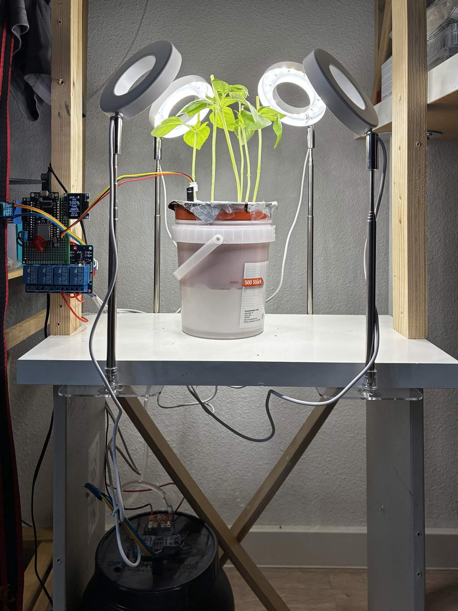

[English](README.md) · **繁體中文**

# 羅勒種植箱：ESP8266 上的閉迴路潮汐式灌溉系統

室內種羅勒，完全沒有自然光，靠一顆讀土壤的泵浦從底部澆水，不看時鐘。



*實際完工的裝置，攝於 2026-09-20。花盆周圍的鋁箔用來擋蕈蚋，刻意留了孔，沒有把盆口封死——為什麼打孔之後還是有效，見[澆水一節](docs/watering.zh-TW.md#防蕈蚋措施之二打孔鋁箔)。幼苗明顯徒長——莖細長、葉片稀疏泛白，下面的[補光燈](docs/grow-light.zh-TW.md)一節有實測數字可以解釋。OLED 上的 `TANK -0.0%` 已經查明：照片攝於 12:41，水位感測器當天最後一次正常讀值是 10:46，而螢幕當下實際印的是 **`-nan%`**，在 18 px 字體下看起來就是 `-0.0%`。詳見[已知問題](docs/known-issues.zh-TW.md)。*

## 總覽

| | |
|---|---|
| 問題 | 室內種羅勒，沒有自然光；計時器看不到土壤；花盆採底部澆水。 |
| 我做了什麼 | 一套閉迴路的潮汐式灌溉：一顆泵浦把定量水灌進外槽，水靠重力排回水箱；電容式土壤探頭決定何時該澆，超音波感測器看守水箱，NodeMCU v3 回報給 Home Assistant。 |
| 結果 | 設定值 1.8cm 實際灌到約 1.9cm（約 247 ml），耗時約 34 秒。四顆補光環合計 6.2W，約為標稱 60W 的一成。移除 `captive_portal:` 之後，Home Assistant 是唯一客戶端，裝置連續跑了 12.8 小時。 |
| 技術堆疊 | ESP8266（NodeMCU v3）搭配 ESPHome，Home Assistant 跑在樹莓派 4 上；單一 12V 電源加三顆 DC-DC 轉換器。 |
| 狀態 | 已部署，尚未完工——待辦見下文。本文最後一筆標註日期的量測是 2026-09-21。 |

## 運作方式

```
                    every 10 min: soil < "Water below"?
                    tank has a full dose above the floor?
                    no drain fault? lockout expired?
                              |
                              v
                    ,----------------------.
                    | FLOOD: pump on        |  poll every 2s, stop on:
                    | (max 120s)             |   - dose reached
                    `----------------------'    - tank floor reached (6cm)
                              |                  - no flow 20s -> re-prime,
                              v                    up to 3x, else abort
                    ,----------------------.
                    | DRAIN: pump off,      |  gravity siphon return,
                    | wait 3 min             |  ~80-90s on the real rig
                    `----------------------'
                              |
                              v
                    ,----------------------.
                    | SOAK: wait 10 min,    |  bottom watering wicks
                    | then read soil        |  upward slowly; reading
                    `----------------------'    immediately reports the
                              |                  transient, not the truth
                    soil >= "Stop at"? --- yes -> done
                              |
                              no, and cycles < "Max cycles" (5)
                              |
                              `---> loop again
```

圖上的英文標籤，對照如下：

- 前置檢查每 10 分鐘跑一次：`土壤 < 「Water below」？`、`水箱扣掉一次澆水量後還高於地板值？`、`沒有 drain fault？鎖定時間已過？`
- `淹灌：泵浦開（時間上限見圖）`——每 2 秒量一次，停在：達到設定水量、觸底（6cm）、或 20 秒沒有水位變化（重新引水，最多 3 次，否則中止）。
- `排水：泵浦關，等待 3 分鐘`——重力虹吸回流，實測約 80–90 秒。
- `靜置：等 10 分鐘，再讀土壤`——底部澆水往上滲透很慢，馬上讀只會讀到表面的暫態，量不到真正的濕度。
- 判斷：`土壤 >= 「Stop at」？ --- 是 -> 完成`；`否，且循環次數 < 「Max cycles」(5)` 就 `---> 再跑一輪`。

- 花盆放在外槽裡；外槽架在水箱上方。
- 單一顆泵浦把測量好的水量灌進外槽，然後直接關閉——外槽會透過同一根管子，以重力虹吸的方式流回水箱。
- 土壤探頭判斷植物是否需要澆水，以及一次循環是否真的有效。水箱上的超音波感測器量測剩餘水量，同時兼作定量控制與缺水保護。
- Home Assistant 是唯一的使用者介面；目前部署的韌體上沒有本機網頁介面。

## 硬體

| 零件 | 型號 | 備註 |
|---|---|---|
| MCU | NodeMCU v3（Lolin），ESP8266EX | 首次燒錄走 USB（CH340），之後走 OTA |
| 土壤濕度 | HW-390 電容式探頭 v2.0 | 供電走 **3V3**，不可用 5V——見[接線](docs/hardware.zh-TW.md#接腳) |
| 水箱液位 | HC-SR04 超音波 | 供電 5V，ECHO 加 1k/2k 分壓，盲區 2cm |
| 箱內環境 | DHT11 | 量的是箱內空氣，沒有量水箱頂部空間 |
| 顯示 | SSD1306 0.96" OLED，I2C 0x3C | 直立安裝（旋轉 90°） |
| 繼電器 | SRD-05VDC-SL-C，4 路板（用 2 路） | JD-VCC 跳線帽已拔除，另外獨立供電 |
| 泵浦 | 潛水式，2.5–6V，約 3W | 兩端跨接一顆 M7 二極體吸收反電動勢 |
| 轉換器 | 2 顆 LM2596S（可調）+ 1 顆 RY8326（固定 5V/3A） | 見[電源](docs/hardware.zh-TW.md#電源) |
| 水箱 | ON Gold Standard 900g 乳清蛋白桶 | 桶身 HDPE #2、蓋子 PP #05，實測有效截面積約 130 cm² |
| 外槽 | PP #05 容器 | 約 500 ml，放進花盆後實際可用水量約 200 ml |

完整的逐點接線說明，含通電前檢查清單，見 [`docs/WIRING.txt`](docs/WIRING.txt)（中英雙語，圖以等寬 ASCII 繪製）。附註：`docs/WIRING.txt` 裡引用的是單純用桶口半徑算出來的幾何截面積（約 143 cm²）；韌體實際用的是實測值（約 130 cm²，也就是水位每變動 1cm 約對應 130 ml），因為桶身往下會收窄，實測值才是真正對應「水位每變動一公分等於多少水量」的數字。

接腳、接錯會燒壞硬體的接線事實、電源實測與 OLED 行為：[docs/hardware.zh-TW.md](docs/hardware.zh-TW.md)。

## 穩定性的故事：裝置為什麼一直重開機

這個專案裡最有意思的工程內容，最後其實不是澆水邏輯本身，而是要先讓裝置本身撐得夠久，才有機會跑完那個循環。

**症狀。** ESP8266 每小時會集中重開機好幾次，每次爆發之間有 86–113 分鐘的正常運作時間；API 客戶端看到的錯誤是 `SocketClosedAPIError`、`EncryptionHelloAPIError`、`HandshakeAPIError`、`TimeoutAPIError`。

**量測。** ping 全程 1–2 ms 正常，API 握手卻每次都失敗；電源實測 5V 輸入 5.23V、3V3 為 3.29V、LED 環負載下 4.42V。裝置對 ping 有反應，不代表它還能服務連線；這幾筆電壓不支持 brownout 的說法（微秒等級的瞬間跌落沒有排除）。

**觸發條件。** 已經有一個 API 客戶端連著時，第二個客戶端發起 Noise 握手，裝置就會當機。23 小時、878 行日誌零次例外重開機；接上第二個客戶端後，3 分鐘內三次 `Exception` 重開。

**修法。** 移除 `captive_portal:`，釋出 2008 B 靜態記憶體（48900 → 46892 B）與 40922 B flash。之後 Home Assistant 是唯一客戶端，裝置連續跑了 12.8 小時。

**還沒結案。** 觸發條件確立了，機制還沒有：交握路徑的程式錯誤與記憶體配置失敗都還活著，因為當機當下的 `max_block` 未知。

操作規則：任何時候只能有一個 API 客戶端；而且光是停掉另一個客戶端不夠，要等裝置自己的 keepalive 逾時。假設表、記憶體證據與 recorder 的教訓：[docs/stability.zh-TW.md](docs/stability.zh-TW.md)。

## 澆水迴圈與安全連鎖

整套邏輯閉迴路看的是土壤濕度，不看澆水量——單次淹灌只讓探頭讀值移動約 5% 量程，超音波約 0.3cm 的解析度對上約 1.7–2.0cm 的澆水量，等於約 20% 的量測粒度。做法是：灌固定水量、排掉、等 10 分鐘往上滲、讀探頭，還不夠濕就再跑一輪。

六道連鎖看守泵浦：6cm 絕對地板值、130 秒看門狗、排水異常鎖定、水箱見底保護、5 次循環上限，以及結構性的 fail-safe（水箱低於外槽、重力排水、強制溢流孔）。

澆水量數字、重新引水、防蕈蚋門檻與打孔鋁箔：[docs/watering.zh-TW.md](docs/watering.zh-TW.md)。

## 補光燈

目前排程：**07:30–00:30 開燈（17 小時）、00:30–07:30 關燈（7 小時）**。韌體裡沒有補光排程，`automation.basil_grow_light_schedule` 由 Home Assistant 掌管；之前三個韌體版本各自敗在不同的地方。

四顆補光環實測合計 6.2W（每顆 4.45V / 0.35A），大約 187 µmol/m²/s，換算到 17 小時排程約 11.4 mol/m²/day，落在羅勒 12–16 DLI 目標的下緣、甚至略低，而且這個估算偏樂觀。安裝高度最關鍵：補光環要貼近冠層，大約高出 10cm；照片裡的幼苗徒長，就是沒維持這個距離的結果。

三個版本與光量計算：[docs/grow-light.zh-TW.md](docs/grow-light.zh-TW.md)。

## Home Assistant 整合

裝置透過 ESPHome 原生 API（`Noise_NNpsk0_25519_ChaChaPoly_SHA256` 加密，金鑰放在 `secrets.yaml`）連到跑 Home Assistant 的樹莓派 4。沒有本機網頁介面，也沒有 MQTT——HA 是唯一的介面。

實體：九個 `sensor`（土壤濕度 %、土壤電壓、水箱 %、水箱深度、水箱距離、箱內溫度、濕度、WiFi 訊號、運作時間）、三個 `binary_sensor`（需要澆水、水箱見底、排水異常）、一個 `switch`（補光燈；補水泵浦刻意不對外開放）、五個 `number`（Dose、Max cycles、Stop at、Water below、Lockout）、四個 `button`（Water now、Calibrate: start fill、Calibrate: save dose、Clear drain fault）。三個告警自動化：排水異常、水箱見底（延遲 5 分鐘）、裝置離線（30 分鐘）。

實體表與告警細節：[docs/home-assistant.zh-TW.md](docs/home-assistant.zh-TW.md)。128×64 OLED 的三種畫面與更新頻率：[docs/hardware.zh-TW.md](docs/hardware.zh-TW.md#oled)。

## 限制與待辦

已確定：重開機的觸發條件。還沒確定：

- 重開機的機制——程式錯誤或記憶體配置失敗——因為故障當下的 `max_block` 未知。
- `pump_min_cm`（目前 6，是猜的）尚未實測。
- 外槽到水箱的溢流孔尚未建置。
- 防蕈蚋乾旱期會不會改變下一次循環，尚未量測。
- 目前補光排程的 dawn 半週期，尚未在實際運作中觀察到。
- NaN 顯示防線已改好、設定檔驗證通過，但還沒燒錄。

完整記錄，包括三小時停擺其實是接頭鬆脫，以及 `-nan%` 的解釋：[docs/known-issues.zh-TW.md](docs/known-issues.zh-TW.md)。

## 建置 / 執行

```sh
cp secrets.yaml.example secrets.yaml
# edit secrets.yaml: at minimum set wifi_ssid / wifi_password.
# The other three keys are usable as-is, or regenerate your own -
# the OTA password is intentionally unset in this config (see comment
# in basil.yaml), and the API key is a base64 Noise PSK ESPHome can
# generate for you.

esphome run basil.yaml --device COM15      # first flash, over USB
esphome run basil.yaml --device basil.local  # subsequent updates, over OTA
```

- `secrets.yaml` 至少要填 `wifi_ssid` / `wifi_password`。
- 另外三個欄位可以直接沿用範例值，也可以自己重新產生：這份設定刻意沒有設定 OTA 密碼（原因見 `basil.yaml` 裡的註解），API 金鑰則是 ESPHome 可以幫你產生的 Noise PSK（格式見上方註解）。
- 第一次燒錄走 USB，序列埠名稱見上方指令；之後的更新走 OTA，裝置名稱是 `basil.local`。

一定要明確帶上 `--device`——單純執行 `esphome run` 會互動式詢問主機位址，在非互動環境下遇到 EOF 就會直接死掉。

這台裝置刻意不設 OTA 密碼：這裡的取捨是，弄丟原始碼樹（連帶弄丟密碼）的機率，判斷起來比「LAN 上有人惡意推送韌體」更高。沒有密碼時的復原方式就是打開機殼、走 USB 重新燒錄。

走 OTA 一樣要遵守「只能有一個 API 客戶端」。先擋住 HA，等它那一側的 socket 清乾淨（約 80 秒），再多等約 2 分鐘讓裝置自己的 keepalive 逾時，才開始上傳；照這個順序，一次上傳只花 **18.34 秒，一次就成功**。把 2 分鐘當成實測有效的最短等待，不要當成有保證的門檻。完整時序與前一晚的兩次失敗：[docs/ota.zh-TW.md](docs/ota.zh-TW.md)。

`basil-bench.yaml` 是另一份已被取代、保留作參考的 build：只有感測器和一個本機網頁介面，沒有繼電器、沒有泵浦、沒有 WiFi——在正式機台組好之前，用來在工作台上讀校正值。它的接線方式不一樣（見檔案開頭的註解區塊），不應該燒進已部署的裝置。

## 檔案結構

```
basil.yaml              the deployed firmware (ESPHome)
basil-bench.yaml         superseded bench build - sensors only, local web UI
secrets.yaml.example     template for secrets.yaml (gitignored)
docs/WIRING.txt          full wiring diagram + pre-power-on checklist
docs/img/                photos referenced from this README
serial-monitor.ps1       raw serial monitor for USB-flash debugging
set-numbers.py           set a `number` entity over the API (bypasses HA)
trigger-water.py         press "Water now" and stream the device log
watch-water.py           same, but reconnects through drops - used to
                         capture a full watering cycle across API resets
```

- 每一列的說明沿用英文：`basil.yaml` 是正式部署的韌體，`basil-bench.yaml` 是已淘汰的工作台 build，`secrets.yaml.example` 是 `secrets.yaml` 的範本（已加入 gitignore）。
- `docs/WIRING.txt` 是完整接線圖與通電前檢查清單；`docs/img/` 放本 README 引用的照片。
- 工具腳本：`serial-monitor.ps1` 是 USB 燒錄除錯用的原始序列埠監看工具；`set-numbers.py` 透過 API 直接設定 `number` 實體（繞過 HA）；`trigger-water.py` 按下「Water now」並串流裝置日誌；`watch-water.py` 功能相同，但斷線會自動重連，用來完整捕捉一次澆水循環。

這三支 Python 腳本都會各自開一條到裝置的 API 連線。根據[穩定性的故事](#穩定性的故事裝置為什麼一直重開機)，只要 Home Assistant 已經連著，這些腳本就會變成第二個客戶端——後果會是裝置直接當機，腳本連線失敗只是小事。執行任何一支之前，都要先把那個連線名額空出來（停掉或擋住 HA 的連線），而且要等裝置自己的 keepalive 逾時，不能只看 HA 那邊的 socket 關掉就以為沒事了。

## 授權

MIT——見 [LICENSE](LICENSE)。
