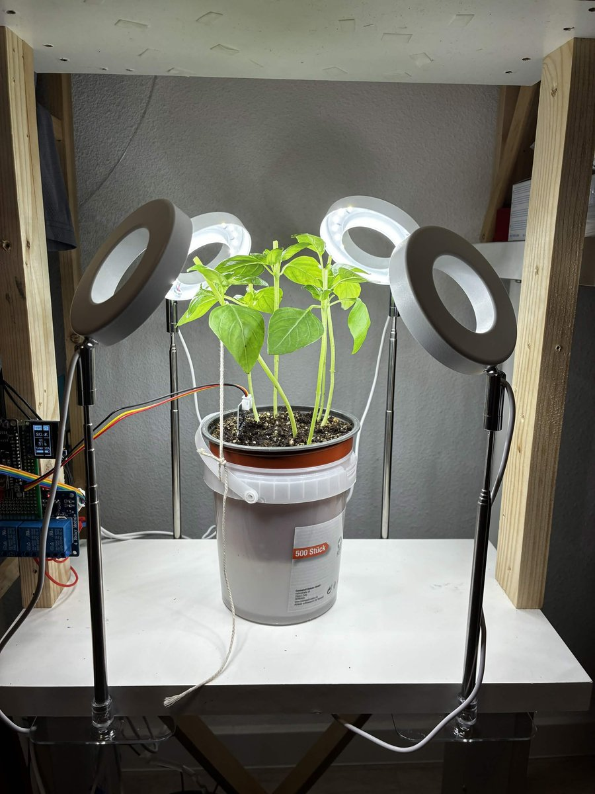
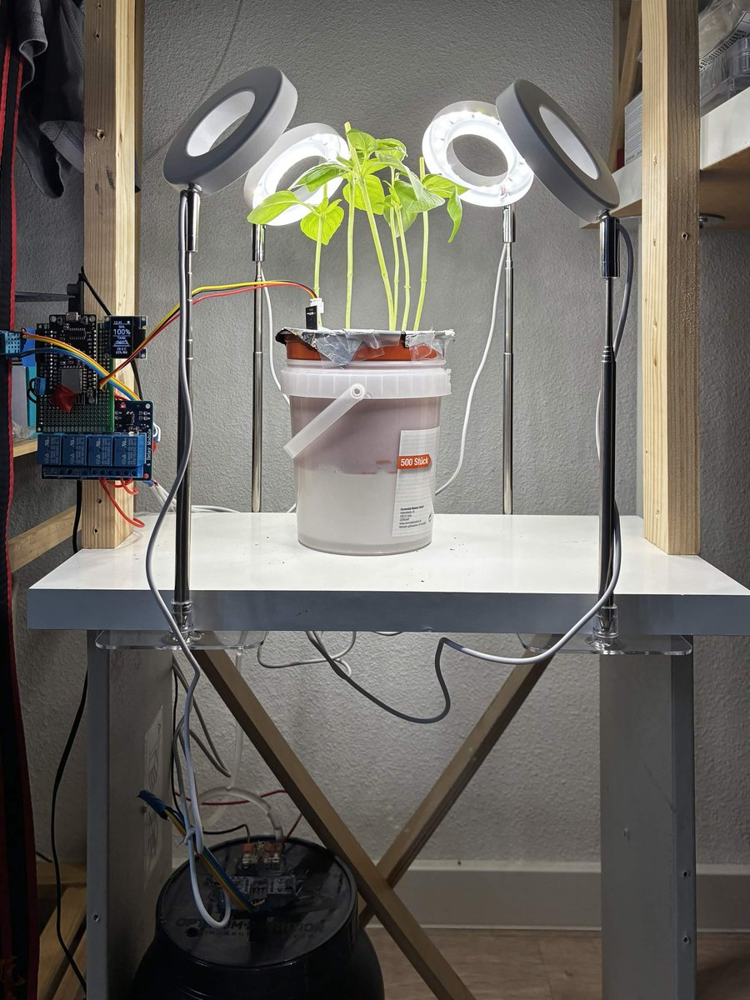

# Watering loop, fungus gnats and safety interlocks

The flow diagram is in the [README](../README.md#how-it-works). This file holds the
measurements behind it, the fungus-gnat measures and the interlocks.

## Dose, overshoot and prime retry

The loop is **closed on soil moisture, not on volume delivered.** A single flood only moves
the soil probe's reading by about 5% of its range, and the ultrasonic sensor's ~0.3cm
resolution against a ~1.7–2.0cm dose is roughly 20% measurement granularity — metering an
exact water volume was never going to be precise enough to be the control variable. So
instead: flood a fixed dose, drain it, wait for it to wick upward, read the probe, and go
again if it's still dry.

- **Dose** delivered in practice: a 1.8cm setpoint delivers ~1.9cm (~247 ml) in ~34s — about
  6s to clear air from the siphon tube plus ~28s of actual flow. The 2-second poll interval
  against an ~0.06–0.07 cm/s fill rate means the loop structurally overshoots its own setpoint
  by ~0.1–0.2cm; setpoint changes smaller than ~0.3cm are inside that noise.
- **Prime retry.** The siphon empties the delivery tube on every drain, so every flood has to
  push roughly a 70cm column of air out of the line first. A small centrifugal pump can't
  self-prime against that reliably. If the tank level hasn't moved in 20 seconds, the pump is
  cut for 3 seconds — letting water fall back and re-flood the impeller housing — then
  restarted. Up to three tries before the cycle aborts as a dry run.

## Fungus gnat control, part 1: the moisture setpoints

`Stop at` moved 70% → 55% and `Water below` moved 30% → 22% (2026-09-20): the soil probe sits
near the surface, so these numbers are effectively an instruction for how wet to keep the top
few centimetres — which is the entire habitat of *Sciaridae* larvae. The root zone stays
saturated from bottom watering either way; only the surface is deliberately kept drier, and a
dry spell of 4–5 days breaks a 3–4 day gnat generation cycle instead of just slowing it down.
The tradeoff is stated plainly right in the firmware comment: raise the threshold back if the
plant itself starts to wilt — the basil is the point, the gnats are a nuisance.

## Fungus gnat control, part 2: perforated foil

| Before | After |
|---|---|
|  |  |
| Bare soil surface | Foil barrier, fitted 2026-09-20 |

Same day as the setpoint change, a second and more direct measure went in: the soil surface is
now covered in **perforated aluminium foil**, denying gnats the moist bare surface they lay
eggs into. It replaced an earlier bread/potato-slice larval trap.

The obvious objection is that any cover should stop evaporation, keep the surface wet, blind
the near-surface probe, and so stop `Water below` from ever firing again. **That objection does
not survive perforation.** Diffusion through a small opening scales with its *radius*, not its
area — a standard result for diffusion through a small aperture: *N* holes give a flux
proportional to *N·r*, while the open area is only *N·π·r²* — so many fine holes evaporate far
better than their tiny total area suggests. Leaves do exactly this: stomata are roughly 1% of
leaf area and pass about 50% of open-water evaporation. This is the reasoning that justified
trying it, not a guarantee — it's the idealized case of isolated, well-spaced apertures, and
the verification below is what actually settles it on this specific pot rather than the theory
alone.

- **Hole size is the real design constraint, and it's about the insect, not the water:** holes
  ≤1mm (pin or drawing-pin). At 2mm and up an adult gnat walks straight through and the
  barrier is decorative. The genuine weak point is the stem openings — those are necessarily
  large, and a single gap there voids the whole sheet, so each one is folded or taped tight
  around its stem.
- **Bonus effects:** the foil reflects light back up into the canopy, and shades the surface
  enough that algae — gnat food in its own right — can't establish.
- **Free, falsifiable verification.** `sensor.basil_soil_voltage` / soil % is already logged
  continuously, so the check costs nothing: watch it over the following days. If it still
  falls past `Water below` (22%) the way it did before the foil went on, evaporation is
  adequate and nothing needs changing. If it plateaus around 30% and stops moving, the
  perforation is too sparse — the fix is more holes, not removing the foil.

  **First reading, 2026-09-21:** after the 09-20 00:00 flood the soil voltage rose steadily
  from 0.3018 V to 0.3213 V by 09-21 10:00 — about +0.0006 V/h, reaching the 0.322 V "settled
  after a flood" anchor after ~34 h. It is drying, not plateaued, but neither outcome above
  has been reached yet; at this rate `Water below` (≈0.412 V) is roughly 6–7 days out. *Why*
  it dries this slowly is not established — there is no no-foil rate from this pot to compare
  against — so it is deliberately not attributed to the foil. One side effect to expect: the
  OLED shows `SOIL 100%` for a long time after watering, because soil % clamps at 100 for
  anything wetter than 0.322 V. That is not a stuck sensor; movement in that range only shows
  in `soil_voltage`.
- **A real hazard worth stating plainly:** foil is electrically conductive, and the relay board
  and 12V rail sit right next to the pot. It's secured for that reason — a loose piece landing
  on a terminal is a genuine failure mode in this build, not a theoretical one. The same
  conductivity is also kept clear of the soil probe's own exposed header pins, for the same
  reason.

## Safety interlocks

None of these are optional; each one guards a specific failure mode observed or reasoned
through during the build.

- **Absolute pump floor (`pump_min_cm`, 6cm).** Checked every 2 seconds inside the flood loop
  regardless of dose progress. A submersible pump is cooled by the water it moves — running
  dry kills it in seconds, faster than the 20s no-flow detector could catch it. *(This value
  is still an estimated placeholder — see [Known issues](known-issues.md#known-issues--open).)*
- **Independent pump watchdog.** A hard 130-second cutoff for the fill pump, built as a
  cancellable `script` rather than an inline `delay:` — ESPHome can't cancel an inline delay,
  so an earlier version fired 130s after the *first* pump start regardless of prime retries
  turning it off and back on in between, which could have cut a legitimately re-primed fill
  short.
- **Drain fault latch — and its actual reset behaviour, which is subtler than it first looks.**
  If more than 40% of a dose's worth of water hasn't returned to the tank by the end of the
  drain wait, `drain_fault` latches `on` and takes over the OLED. The automatic 10-minute
  trigger checks the latch and refuses to start a new cycle while it's set — but the manual
  `button.basil_water_now` ("Water now") does **not** check it, and will run a cycle
  regardless. That matters because `drain_fault` is recomputed at the end of *every*
  `water_cycle` run, whichever trigger started it: if that run completes with water actually
  returning, the flag clears itself; if the run aborts as a dry run (or never had enough water
  above the floor to attempt a cycle at all), the flag is left exactly as it was.
  `button.basil_clear_drain_fault` is the only path that clears it without running water at
  all.
- **Tank-empty guard.** `tank_cm < pump_min_cm` triggers `binary_sensor.basil_tank_empty`
  before any cycle is allowed to run; the Home Assistant alert debounces this 5 minutes to
  ride out the ordinary transient dip during an active flood.
- **Max cycles cap (5).** A capacitive probe with poor soil contact reads falsely dry (a real
  failure seen during planting: after thinning, an air-gapped probe read 50–51% in saturated
  soil until the soil was firmed back around it). Without a hard cap, a lying probe would
  flood the tray indefinitely.
- **Structural, not software, fail-safe on drainage.** The reservoir sits *below* the tray.
  Pump off — for any reason, including a power cut — means gravity drains the tray back down
  on its own; there is no drain pump or H-bridge to fail in the wrong direction. A welded
  relay contact is the one failure this can't protect against on its own, which is why the
  tray also has a **mandatory overflow port** back to the tank, sized for the fact that the
  tank holds roughly ten times what the tray can (~2.3 L tank vs ~200 ml usable tray).
