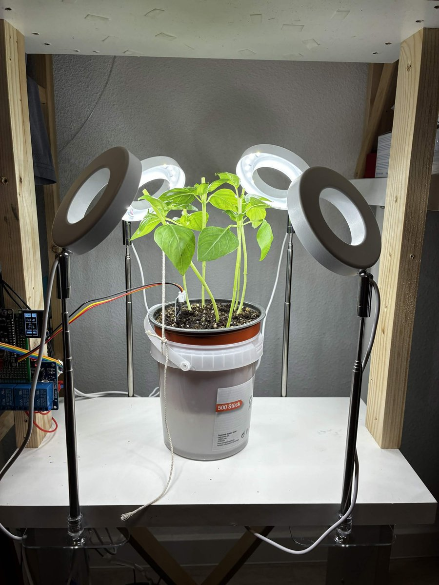
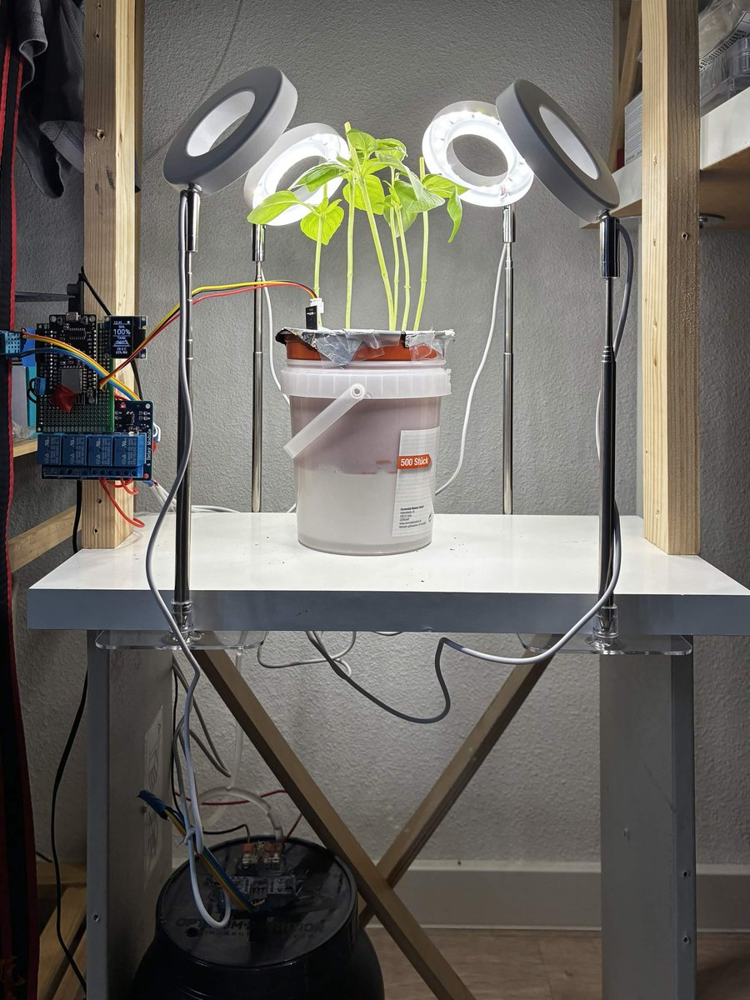

# 澆水迴圈、防蕈蚋與安全連鎖

流程圖留在 [README](../README.zh-TW.md#運作方式)。這裡放流程圖背後的實測數字、防蕈蚋的兩種做法，以及安全連鎖。

## 澆水量、超量與重新引水

整套邏輯閉迴路看的是土壤濕度，控制變數並不是澆水量。單次淹灌只會讓土壤探頭的讀值移動大約 5% 的量程，而超音波感測器約 0.3cm 的解析度，對上約 1.7–2.0cm 的單次澆水量，等於約 20% 的量測粒度——精確計量水量從一開始就不可能作為控制變數。所以邏輯改成：淹灌固定水量、放水排掉、等它往上滲透、讀一次探頭，還不夠濕就再來一次。

- **實際澆水量：** 設定值 1.8cm 實際會灌到約 1.9cm（約 247 ml），耗時約 34 秒——大約 6 秒用來把虹吸管裡的空氣排出，剩下約 28 秒才是真正在灌水。每 2 秒一次的輪詢，對上約 0.06–0.07 cm/s 的注水速率，代表這個迴圈在結構上就會超出設定值約 0.1–0.2cm；設定值變動小於約 0.3cm 基本上都落在這個雜訊範圍內。
- **重新引水（prime retry）。** 每次排水都是靠重力虹吸把送水管路裡的水排空，所以每次淹灌開始時，泵浦都得先把管路裡大約 70cm 高的空氣柱推出去，才能真正把水送上去。小型離心泵浦沒辦法穩定地自行對抗這段空氣柱完成引水。如果水箱液位 20 秒內完全沒有變化，泵浦就會關 3 秒——讓水回流灌滿泵殼——再重新啟動，最多重試三次，否則這次循環就以「乾轉」中止。

## 防蕈蚋措施之一：濕度門檻

`Stop at` 從 70% 調到 55%，`Water below` 從 30% 調到 22%（2026-09-20）：土壤探頭位置偏表層，這兩個數字實質上是在指定「表層要維持多濕」——而表層那幾公分正是蕈蚋（*Sciaridae*）幼蟲的全部棲地。根系那一層無論如何都會因為底部澆水而維持飽和；只有表層被刻意調乾，而 4–5 天的乾旱期剛好可以打斷牠們 3–4 天一代的繁殖週期，而不只是拖慢牠。這個取捨在韌體的註解裡寫得很直白：如果植株真的開始萎蔫，就把門檻調回去——羅勒本身才是重點，蕈蚋只是討厭而已。

## 防蕈蚋措施之二：打孔鋁箔

| 裝設前 | 裝設後 |
|---|---|
|  |  |
| 土壤表層裸露 | 鋁箔屏障，2026-09-20 裝上 |

跟調整濕度門檻同一天，又加上了第二個、更直接的防治手段：土壤表面現在包了一層**打了孔的鋁箔**，不讓蕈蚋接觸到牠們產卵所需的濕潤裸土。這取代了原本用麵包／馬鈴薯片做的幼蟲誘捕陷阱。

一個直覺上很合理的質疑是：任何覆蓋物都會擋住蒸發，讓表層維持濕潤，讓貼近表層的探頭失真，於是 `Water below` 永遠不會再觸發。**但這個質疑撐不過「打孔」這件事。** 透過小孔的擴散速率跟孔的**半徑**成正比，而不是跟面積成正比——這是小孔擴散的標準結果：N 個孔的擴散通量正比於 N·r，開孔面積卻是 N·π·r²——所以很多細小的孔，蒸發效果遠比它們加起來那一點點開孔面積所暗示的要好得多。葉片本身就是這樣運作的：氣孔只占葉片面積約 1%，卻能通過約 50% 的開放水面蒸發量。這個推論只是當初決定這樣做的理由，並不是保證——它成立的前提是孔洞彼此分得夠開、各自獨立這個理想情況，下面那個驗證方式才是真正在這個花盆上拍板定案的依據，不是理論本身。

- **孔徑才是真正的設計限制，而且這個限制是衝著蟲來的，跟水無關：** 孔徑要 ≤1mm（用大頭針或圖釘打孔）。到了 2mm 以上，成蟲直接就能走過去，屏障形同虛設。真正的弱點是莖穿出的開口——那些開口本來就必須夠大，任何一處沒貼緊，整張鋁箔的防護就破功，所以每一根莖都要把鋁箔摺緊、用膠帶貼牢。
- **附帶效果：** 鋁箔會把光反射回植株冠層，同時遮蔽表層讓藻類（蕈蚋的食物來源之一）長不起來。
- **免費、可證偽的驗證方式。** `sensor.basil_soil_voltage`／土壤濕度本來就會持續記錄，所以這個檢查完全不用額外成本：接下來幾天觀察它的走勢。如果它還是像包箔之前一樣會跌破 `Water below`（22%），代表蒸發量足夠，不用改動任何東西。如果它卡在 30% 左右不再往下掉，代表打孔密度不夠——與其拆掉鋁箔，不如多打幾個孔。

  **第一筆讀值（2026-09-21）：** 09-20 00:00 淹灌後，土壤電壓從 0.3018 V 穩定上升，到 09-21 10:00 來到 0.3213 V——約每小時 +0.0006 V，約 34 小時後達到 0.322 V 的「淹灌後靜置」錨點。土壤確實在變乾，並未停滯，但上述兩種結果都還沒出現；照這個速度，距離 `Water below`（約 0.412 V）大概還有 6～7 天。至於**為什麼**乾得這麼慢，目前尚無定論——這個盆子沒有未包鋁箔時的乾燥速率可供對照——因此這裡刻意不把它歸因於鋁箔。有一個可以預期的副作用：澆水後 OLED 會長時間顯示 `SOIL 100%`，因為比 0.322 V 更濕的讀值一律被鎖在 100%。這不是感測器卡住，該區間內的變化只會反映在 `soil_voltage`。
- **一個值得老實講出來的真實風險：** 鋁箔會導電，而繼電器板和 12V 電源軌就在花盆旁邊。之所以要把它固定牢，正是因為這一點——鬆脫的鋁箔片掉到接點上，在這套裝置裡真的會發生，並非空談。同樣的導電性，也要留意別碰到土壤探頭自己外露的接腳。

## 安全連鎖機制

以下每一項都不是可有可無的裝飾，各自對應一個在製作過程中實際觀察到、或經過推演確認的失效模式。

- **泵浦絕對地板值 (`pump_min_cm`，6cm)。** 在淹灌迴圈中每 2 秒檢查一次，不管澆水量進度到哪都會生效。潛水泵浦靠所抽送的水來散熱——乾轉幾秒就會壞掉，比 20 秒的無水流偵測還快。*（這個數值目前仍是估計值，尚未實測——見[已知問題](known-issues.zh-TW.md#已知問題--待辦)。）*
- **獨立的泵浦看門狗。** 對補水泵浦設一個 130 秒的硬性上限，而且是用可以中途取消的 `script` 寫的，不是內嵌的 `delay:`——ESPHome 沒辦法取消內嵌的 delay，早期版本因此會在**第一次**泵浦啟動後 130 秒觸發，完全不管中間有沒有因為重新引水而關了又開，這樣可能會把一次正常的重新引水攔腰砍斷。
- **排水異常鎖定——以及它實際的解除方式，比第一眼看起來要細膩一些。** 如果排水結束時，超過一次澆水量的 40% 沒有回到水箱，`drain_fault` 會鎖定為 `on`，並接管 OLED 顯示。每 10 分鐘一次的自動觸發會檢查這個鎖定狀態，鎖定中就不會啟動新的循環——但手動按下的 `button.basil_water_now`（「Water now」）**不會**檢查這個狀態，還是會直接跑一次循環。這一點很關鍵，因為 `drain_fault` 是在**每一次** `water_cycle` 執行結束時重新計算的，不管是被哪個觸發器啟動的：如果那次循環最後水真的有流回來，鎖定就會自動解除；如果那次循環是以「乾轉」中止收場（或者水箱本來就不夠水，連一次循環都沒真的跑），鎖定狀態則完全維持原樣不變。`button.basil_clear_drain_fault` 則是唯一一個完全不用跑水、直接把鎖定解除的方式。
- **水箱見底保護。** `tank_cm < pump_min_cm` 會觸發 `binary_sensor.basil_tank_empty`，任何循環都無法在這個狀態下啟動；Home Assistant 的告警會延遲 5 分鐘才通知，用來過濾掉淹灌過程中正常的短暫水位下降。
- **最大循環次數上限（5）。** 接觸不良的電容式探頭會誤讀成乾燥（種植過程中真的遇過：疏苗後探頭周圍出現空氣間隙，即使土壤已經飽和，讀值仍卡在 50–51%，直到把土重新壓實在探頭周圍為止）。沒有這個上限，一個說謊的探頭會讓外槽無止盡地被淹灌。
- **靠結構、不靠軟體的排水 fail-safe。** 水箱的位置**低於**外槽。不論什麼原因讓泵浦停止——包括斷電——重力都會自動把外槽的水排回水箱；沒有排水泵浦或 H 橋這種可能往錯誤方向失效的元件。唯一這套結構擋不住的情況是繼電器接點燒黏，因此外槽另外設計了**強制溢流孔**通回水箱，尺寸是按水箱容量大約是外槽十倍這件事（水箱約 2.3 L，外槽實際可用約 200 ml）抓的。
